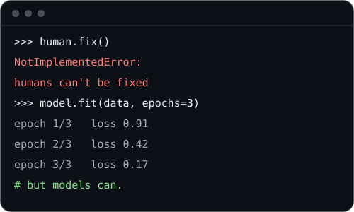

<h1 align="center">Hi 👋, I'm Nour Alhalwagy</h1>
<h3 align="center">"Junior Data Scientist &amp; Machine Learning Engineer"</h3>

  

- Know about my experience [Here](https://github.com/nouralhalwagy/nouralhalwagy/blob/main/resume.pdf)

- Ask me about **Machine Learning, Computer Vision and Reinforcement Learning**

- How to reach me **[nourtamer553@gmail.com](mailto:nourtamer553@gmail.com)**

- I'm currently building **a community that gives girls across the Middle East more exposure to tech**

<h3 align="left">Connect with me:</h3>

&nbsp;
&nbsp;

## Technical Stack:

### 🖥️ Programming Languages

### 📊 Data

### 🤖 Machine Learning

### 👁️ Computer Vision

### 🎮 Reinforcement Learning

### 🧠 LLMs

### 🚀 Deployment

