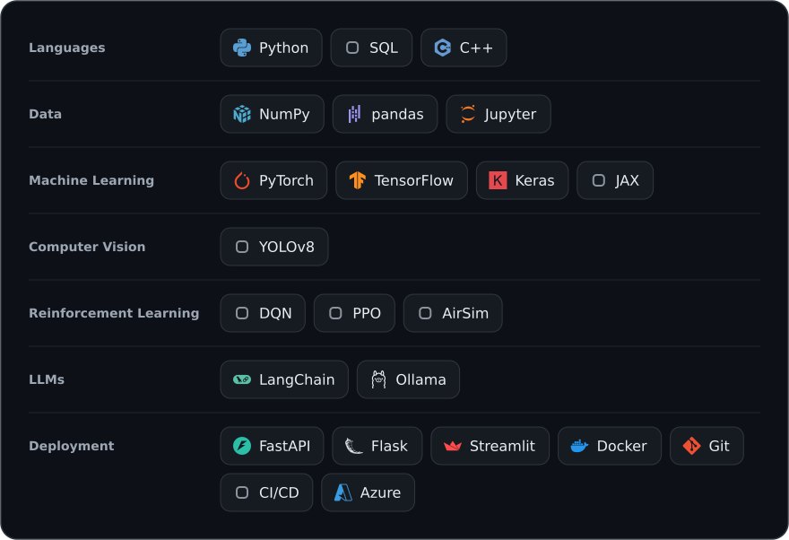

# Nour Alhalwagy

**Junior Data Scientist & Machine Learning Engineer** · Cairo, Egypt

I like knowing why a method works before relying on it, so some of my projects build the algorithm from scratch instead of calling a library.

I study Computer Science and AI at Benha University (class of 2027), majoring in Information Security and Digital Forensics. I completed the Digital Egypt Pioneers Initiative (DEPI) AI & Data Science track as a Microsoft Machine Learning Engineer Trainee.

## Skills

## Projects

**[Autonomous Drone](https://github.com/Arwa-Hamdy-Mohammdy/autonomous-drone)** (team project)  
Deep reinforcement learning (DQN/PPO) in the AirSim simulator, with YOLOv8 object detection, to navigate toward and track a target vehicle.

**[LLM Agent in a Simulated Room](https://github.com/nouralhalwagy/llm-world-agent)**  
A LangChain agent that controls a robot in a small text-based world, running llama3.1 locally through Ollama. An early trial for a research paper.

**[Checkers: Human vs AI](https://github.com/nouralhalwagy/Checkers)**  
A playable Checkers game in Python and Pygame, with an AI opponent built on Minimax and Alpha-Beta pruning.

**[Gaussian Elimination Solver](https://github.com/nouralhalwagy/gaussian-elimination)**  
A from-scratch NumPy solver for 3×3 linear systems that also detects when a system has no solution or infinitely many.

## Currently

- Building Smart AI Driving Alert, a demo system that helps drivers avoid traffic penalties.
- Vice-Head of AI & Data Science at Google Developer Groups on Campus, Benha University.
